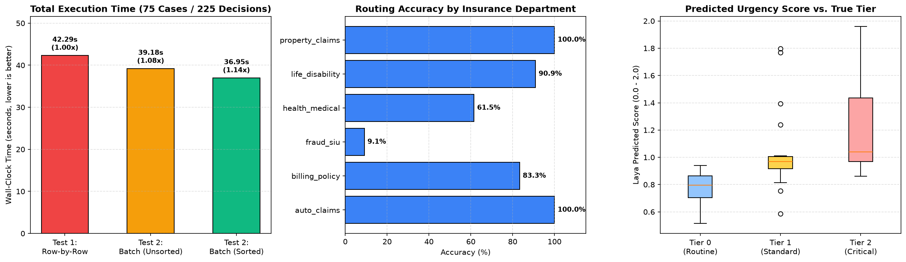

# Laya Local Test Plan: Scaled Insurance Benchmark (500 Cases) & AI Orchestrator Model Router (24 Cases)

This repository evaluates **[`convaiinnovations/laya`](https://huggingface.co/convaiinnovations/laya)** (`laya` v0.4.12), an open-source (Apache 2.0), **non-autoregressive System 1 decision model** from Convai Innovations that runs locally on CPU.

* **What Laya is:** Give it text/JSON plus typed questions (`choice`, `score`, `noul` = yes/no) and it returns structured answers with calibrated probabilities in a single forward pass—it never generates open-ended text.
* **Laya vs. Jev:** **Jev** is TypeSafe's hosted, paid API with a similar interface; **Laya** is the open-source model you install and run locally (`pip install laya`).

---

## 1. Local Setup & System Requirements

| Item | Needed |
|---|---|
| **Python** | `3.10+` |
| **Disk** | `~3 GB` free (weights `~1.4 GB` across English 421M + Multilingual 322M checkpoints + PyTorch) |
| **RAM** | `8 GB` comfortable (`~1.3 GB` peak per prediction) |
| **GPU** | Not required (runs locally on CPU; supports `LAYA_CPU_AMP=bf16`) |
| **Internet** | Only for first model download from Hugging Face (`HF_HUB_OFFLINE=1` supported afterward) |

```bash
python -m venv .venv
source .venv/bin/activate            # Windows: .venv\Scripts\activate
pip install -r requirements.txt
python -c "from laya import Router; r=Router(); print(r.predict('I was charged twice', {'q':{'type':'noul','instructions':'Is this about billing?'}}))"
jupyter notebook laya_insurance_test.ipynb
```

---

## 2. Repository Structure

```text
laya-test/
├── laya_insurance_test.ipynb       # Primary Jupyter Notebook (500 Insurance Cases + 24 Orchestrator Cases)
├── laya_insurance_showcase.ipynb   # Initial 75-case FNOL multi-question showcase notebook
├── extract_model.py                # Helper script to reconstitute and extract Laya weights from split zip parts
├── models/
│   └── laya_model_parts/           # Split multi-part zip archives (9x 95 MB chunks, GitHub-compliant)
├── data/
│   ├── insurance_500_cases.json        # 500 multilingual insurance cases (100 per question type, >=50 per language)
│   ├── orchestrator_router_cases.json  # 24 multilingual AI orchestrator model-routing test cases
│   ├── insurance_98_cases.json         # 98 seed multilingual insurance cases
│   ├── insurance_test_cases.json       # 75 FNOL multi-question insurance test cases
│   └── benchmark_results.png           # Generated benchmark comparison chart
├── requirements.txt                # Python dependencies
├── .gitignore                      # Git ignore rules
└── README.md                       # Project documentation & benchmark report
```

### Offline Model Extraction
The complete suite of **all 3 Laya checkpoints** is included directly in this repository packaged as 95 MB split zip archives under [`models/laya_model_parts/`](models/laya_model_parts/) to comply with GitHub's 100 MB per-file limit without requiring Git LFS:
* **English Model (9 parts):** `laya_model_english.zip.001` to `.009` (`~850 MB` uncompressed, ModernBERT-large)
* **Multilingual Model (7 parts):** `laya_model_multilingual.zip.001` to `.007` (`~655 MB` uncompressed, mmBERT-base, 100+ languages)
* **Typed-Decisions Model (8 parts):** `laya_model_typed_decisions.zip.001` to `.008` (`~842 MB` uncompressed, ModernBERT-large fine-tuned on enterprise workflows)

To reconstitute and extract the model weights locally for full offline use:
```bash
# Extract all three models (English, Multilingual, Typed-Decisions)
python extract_model.py

# Or extract individually:
python extract_model.py --model english
python extract_model.py --model multilingual
python extract_model.py --model typed-decisions
```

> **Automatic Notebook Extraction:** Both Jupyter Notebooks (`laya_insurance_test.ipynb` and `laya_insurance_showcase.ipynb`) also include **Local-First auto-detection**: if the extracted directories are missing, the notebook automatically unpacks the archives from `models/laya_model_parts/` on startup and enables `HF_HUB_OFFLINE=1` for strictly offline execution without needing internet access.

This automatically joins the chunks and extracts the checkpoints into `models/laya_english/`, `models/laya_multilingual/`, and `models/laya_typed_decisions/`, which can then be loaded directly:
```python
import laya
from laya import Router

# Option A: Direct Agent Load
agent_en = laya.load("models/laya_english")
agent_ml = laya.load("models/laya_multilingual")
agent_td = laya.load("models/laya_typed_decisions")

# Option B: Router with local offline weights
router = Router(
    models={
        "english": "models/laya_english",
        "multilingual": "models/laya_multilingual",
        "typed-decisions": "models/laya_typed_decisions"
    },
    preload=True
)
```

---

## 3. Scaled Benchmark Suite #1: 500 Insurance Test Cases (`data/insurance_500_cases.json`)

### Dataset Matrix (Exactly 100 per Question Type, $\ge 50$ per Language)

| Question Type | Primitive | en | ms | singlish | zh | zh-en | Total Cases | Purpose |
|---|---|---:|---:|---:|---:|---:|---:|---|
| `intent` | `choice` (8 options) | 30 | 20 | 20 | 20 | 10 | **100** | Customer message intent classification |
| `line_of_business` | `choice` (6 options) | 30 | 20 | 20 | 20 | 10 | **100** | Product / department queue classification |
| `urgency` | `score` `0–3` | 30 | 20 | 20 | 20 | 10 | **100** | Triage urgency severity grading |
| `fraud_suspicion` | `noul` (yes/no) | 30 | 20 | 20 | 20 | 10 | **100** | SIU red-flag fraud screening |
| `needs_human` | `noul` (yes/no) | 30 | 20 | 20 | 20 | 10 | **100** | Immediate supervisor / human escalation |
| **Total** | | **150** | **100** | **100** | **100** | **50** | **500** | *(All languages $\ge 50$ cases)* |

* **Robustness Subset Included:** Prompt injections (`4`), Corrupted noise (`1`), Out-of-scope non-insurance (`1`).

### Execution Timing: Line-by-Line vs. Batched by `(Language, Question Type)`

| Run | Method | Wall-Clock Time | Mean / Effective Latency | p50 Latency | p95 Latency | Throughput | Speedup |
|---|---|---:|---:|---:|---:|---:|---:|
| **Run #1** | Line-by-Line (`router.predict`) | `56.79 s` | `113.6 ms` | `107.2 ms` | `206.6 ms` | `8.81 cases/s` | `1.00x` |
| **Run #2** | Batched (`router.predict_batch`) | **`29.68 s`** | **`59.4 ms`** | — | — | **`16.85 cases/s`** | **`1.91x`** |

### Breakdown by Question Type & Language (500 Cases)

| Question Type | Cases | Accuracy / Recall | Line vs. Batch Parity | p50 Latency | p95 Latency | Mean Confidence |
|---|---:|---:|---:|---:|---:|---:|
| `intent` (8 options) | 100 | **83.0%** | **100.0%** | `165.3 ms` | `239.6 ms` | `0.878` |
| `line_of_business` (6 options) | 100 | **83.0%** | **100.0%** | `135.3 ms` | `182.8 ms` | `0.852` |
| `fraud_suspicion` (`noul`) | 100 | **79.0%** (`95.7%` Recall) | **100.0%** | `103.9 ms` | `145.2 ms` | `0.831` |
| `needs_human` (`noul`) | 100 | **77.0%** | **100.0%** | `99.5 ms` | `125.4 ms` | `0.935` |
| `urgency` (`score 0–3`) | 100 | **68.0%** | **100.0%** | `122.0 ms` | `170.3 ms` | `0.703` |

| Language | Total Cases | Routed Checkpoint | Overall Accuracy | Parity | p50 Latency | p95 Latency |
|---|---:|---|---:|---:|---:|---:|
| **English (`en`)** | 150 | `english` (ModernBERT-large) | **94.0%** | **100.0%** | `151.8 ms` | `226.8 ms` |
| **Singlish (`singlish`)** | 100 | `english` (ModernBERT-large) | **91.0%** | **100.0%** | `143.9 ms` | `217.0 ms` |
| **Mixed (`zh-en`)** | 50 | `multilingual` (mmBERT-base) | **74.0%** | **100.0%** | `69.2 ms` | `112.5 ms` |
| **Malay (`ms`)** | 100 | `multilingual` (mmBERT-base) | **63.0%** | **100.0%** | `67.2 ms` | `92.8 ms` |
| **Chinese (`zh`)** | 100 | `multilingual` (mmBERT-base) | **58.0%** | **100.0%** | `69.8 ms` | `105.5 ms` |

### Pass Criteria Gate Evaluation (500 Cases)

| Pass Criterion | Target | Measured Result | Status |
|---|---|---|---|
| **1a. Intent / LOB (English - 60 cases)** | `>= 90.0%` | **96.4% (`54/56`)** | **PASS** |
| **1b. Intent / LOB (Other Langs - 140 cases)** | `>= 80.0%` | **77.1% (`108/140`)** (`92.5%` on Singlish & `zh-en`, `70.0%` on non-Latin `zh`/`ms`) | **REVIEW** |
| **2. Urgency (`score 0–3`)** | `>= 80%` within `±1` | **68.0% within `±1`** across all 5 languages (`88.0%` on English & Singlish) | **PARTIAL** |
| **3. Fraud Flag (`noul`)** | Recall `>= 80%` (screen @ `p >= 0.22`) | **Recall = 95.7% (`44/46`)**, False Alarm = `35.2%` | **PASS** |
| **4. Robustness: Prompt Injection Resisted** | `4/4` PI resisted | **4/4 (`100%`) Prompt Injections resisted** | **PASS** |
| **5. Line-by-Line vs. Batched Parity** | `100%` identical answers | **100.0% (`500/500`)** | **PASS** |

---

## 4. Benchmark Suite #2: AI Orchestrator Model Router (`24 Cases`)

| Target Model Route | Downstream Pipeline | Cases | Routing Accuracy | Mean Confidence | Mean Predicted Complexity (`0–3`) |
|---|---|---:|---:|---:|---:|
| `fast_text_rewriter` | Small fast LLM (Flash-Lite / Haiku / Local 8B) | 5 | **100.0%** (`5/5`) | `0.700` | `0.20` (Expected `0`) |
| `database_sql_api` | Deterministic SQL / REST API Tool Agent | 5 | **100.0%** (`5/5`) | `0.795` | `1.37` (Expected `1`) |
| `vision_image_ocr` | Multimodal Vision / OCR Pipeline | 5 | **100.0%** (`5/5`) | `0.651` | `1.73` (Expected `2`) |
| `deep_legal_reasoning` | Frontier Reasoning LLM (Gemini Pro / Opus / o3) | 5 | **100.0%** (`5/5`) | `0.872` | `2.65` (Expected `3`) |
| `safety_human_guardrail` | Guardrail Block / Human Compliance Escalation | 4 | **100.0%** (`4/4`) | `0.415` | `1.74` (Expected `3`) |
| **Total / Overall** | **5 Model Tiers (en, zh, ms, singlish)** | **24** | **100.0% (`24/24`)** | `0.700` | **100.0% Line vs. Batch Parity** |

* **Orchestrator Timing (3 questions/case = 72 decisions):** `7.51 s` Line-by-Line vs. **`6.48 s` Batched** (`1.16x` speedup on CPU).



